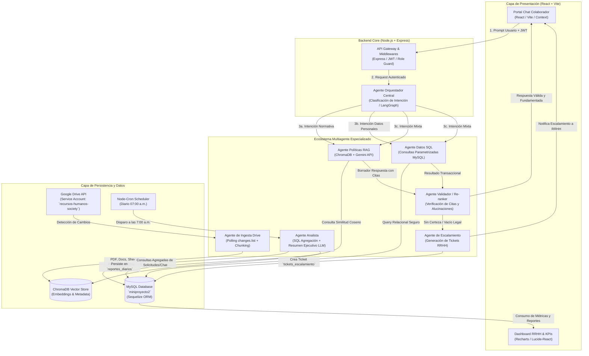

# ARQUITECTURA TÉCNICA DEL SISTEMA Y DISEÑO MULTIAGENTE CON RAG
## PORTAL DE CONSULTA DE POLÍTICAS DE RRHH Y GESTIÓN DE PERSONAL (RHSOCIETY)

---

**Organización:** RHsociety S.A.  
**Sistema:** Portal Inteligente de Recursos Humanos Multiagente con RAG  
**Versión:** 1.0  
**Fecha:** Noviembre de 2026  
**Entorno de Datos:** MySQL (`miniproyecto2`) & ChromaDB Vector Store  

---

## 1. RESUMEN ARQUITECTÓNICO

El sistema **RHsociety** está diseñado bajo una arquitectura de micro-servicios desacoplada y orientada a agentes inteligentes coordinados mediante un **Orquestador Central**. Combina la precisión transaccional y relacional de un sistema ERP/RDBMS tradicional (MySQL) con la flexibilidad semántica de un pipeline de **Generación Aumentada por Recuperación (RAG)** multi-formato (Markdown, PDF, Excel) sincronizado directamente desde **Google Drive**.

El sistema atiende dos modalidades de usuarios con roles diferenciados:
1. **Colaboradores (Empleado Estándar):** Consultas conversacionales sobre políticas de RRHH, consulta de su propio saldo de vacaciones, registro y seguimiento de solicitudes de permisos o incapacidades.
2. **Administradores (Recursos Humanos / People Ops):** Supervisión integral de solicitudes, auditoría de consultas y tickets de escalamiento, visualización de KPIs de ausentismo y rotación, y acceso a los reportes analíticos consolidados generados diariamente a las 7:00 a. m.

---

## 2. DIAGRAMA GENERAL DE ARQUITECTURA TÉCNICA

A continuación se ilustran los tres flujos fundamentales del sistema: el **Flujo Conversacional Multiagente**, el **Flujo de Ingesta Sincronizada desde Google Drive** y el **Flujo de Reportes Diarios Automatizados**.

---

## 3. DESCRIPCIÓN DETALLADA DE LOS TRES FLUJOS OPERATIVOS

### 3.1. Flujo Conversacional Multiagente
1. **Autenticación e Ingreso:** El colaborador ingresa al portal mediante JWT. Su `id`, `rol` y `departamento` se adjuntan en la cabecera de la petición HTTP.
2. **Enrutamiento y Clasificación:** El **Agente Orquestador** analiza el mensaje del usuario y clasifica la intención mediante patrones semánticos y modelos de lenguaje:
   - *Intención Normativa (Políticas):* Derivada al **Agente de Políticas RAG**.
   - *Intención Transaccional (Datos del empleado):* Derivada al **Agente de Datos SQL** (ej. saldos de vacaciones, estado de solicitudes, fecha de próximo pago).
   - *Intención Mixta:* Se ejecutan en paralelo ambos agentes y el orquestador sintetiza los resultados.
3. **Recuperación Vectorial (RAG):** El Agente de Políticas consulta en **ChromaDB** utilizando embeddings generados con `text-embedding-004` (o la API de Gemini), recuperando los *k* chunks más relevantes con sus respectivos metadatos (`documento`, `seccion`, `version`).
4. **Validación Antialucinación:** El **Agente Validador** audita la respuesta generada por el LLM contra los fragmentos recuperados. Verifica que toda afirmación legal esté debidamente citada (`POL-XX`, Sección X.X). Si el nivel de confianza es inferior al umbral o la información no existe en las políticas:
   - Deriva al **Agente de Escalamiento**, quien registra un registro en la tabla `tickets_escalamiento` y notifica al colaborador que su consulta fue transferida a un especialista de RRHH.
5. **Registro de Telemetría:** Cada interacción queda registrada en la tabla `consultas_chat` para análisis de satisfacción, latencia y consultas frecuentes.

### 3.2. Flujo de Ingesta Inteligente desde Google Drive
1. **Detección de Novedades:** El **Agente de Ingesta** utiliza la API de Google Drive (`drive.changes.list`) para monitorear modificaciones en la carpeta designada por `GOOGLE_DRIVE_FOLDER_ID`.
2. **Procesamiento Multi-Formato:**
   - *Documentos Markdown / Docs (`.md`):* Particionado jerárquico por encabezados semánticos (`#`, `##`, `###`).
   - *Archivos PDF (`.pdf`):* Extracción de texto estructurado con `pdf-parse`, eliminación de encabezados/pies de página repetitivos y chunking con solapamiento (*overlap* de 150 caracteres).
   - *Hojas de Cálculo (`.xlsx`):* Lectura de celdas y filas mediante la librería `xlsx`, convirtiendo filas tabulares en sentencias semánticas enriquecidas con metadatos de fila y hoja.
3. **Indexación Vectorial:** Cada chunk es vectorizado y almacenado en **ChromaDB** con metadatos clave: `fuente`, `codigo_politica`, `titulo_seccion`, `fecha_vigencia` y `hash_contenido` para evitar duplicidades.

### 3.3. Flujo de Reportes Diarios y Analítica RRHH
1. **Planificador Automatizado:** Un job de `node-cron` se activa automáticamente todos los días a las **07:00 a. m.** (hora de Costa Rica).
2. **Agregación de Datos:** El **Agente Analista** ejecuta consultas SQL sobre MySQL:
   - Volumen de solicitudes pendientes, aprobadas y rechazadas en las últimas 24 horas.
   - Colaboradores en condición de incapacidad activa o vacaciones.
   - Consultas de chat recibidas, tasa de resolución autónoma y tasa de escalamiento.
   - Tendencias temáticas más consultadas por los colaboradores.
3. **Síntesis Ejecutiva por LLM:** Con los datos estructurados, el Agente invoca a Gemini para redactar un resumen ejecutivo en lenguaje natural estructurado.
4. **Persistencia y Visualización:** El resultado se guarda en la tabla `reportes_diarios` y queda inmediatamente disponible en el **Dashboard de RRHH** para visualización mediante componentes gráficos de Recharts.

---

## 4. JUSTIFICACIÓN TÉCNICA DEL STACK TECNOLÓGICO

| Componente | Tecnología Seleccionada | Justificación Técnica y Beneficio Operativo |
| :--- | :--- | :--- |
| **Backend Runtime** | **Node.js (v20+ / v24) + Express (ES Modules)** | Arquitectura asíncrona no bloqueante de alto rendimiento para I/O concurrente (consultas HTTP, llamadas a APIs externas de Gemini y Google Drive). Unifica JavaScript en todo el stack. |
| **Base de Datos Relacional** | **MySQL (`miniproyecto2`) + Sequelize ORM** | Garantiza consistencia transaccional ACID en el control de vacaciones, historial de incapacidades y movimientos de personal. El uso de Sequelize ORM previene inyecciones SQL y facilita migraciones reproducibles. |
| **Base de Datos Vectorial** | **ChromaDB (Local Persistent)** | Almacén vectorial local optimizado para embeddings con soporte de filtrado avanzado por metadatos (ej. filtrar por código de política o fecha). Evita costos recurrentes de bases vectoriales SaaS en la nube. |
| **Modelos de Lenguaje & Embeddings** | **Google Gemini API (`@google/genai`)** | Tiempos de respuesta ultrarrápidos, capacidad nativa para procesamiento de contextos amplios, excelente comprensión del lenguaje normativo costarricense y facilidad de extracción estructurada en JSON. |
| **Frontend Framework** | **React (Vite) + Context API** | Compilación ultrarrápida y recarga en caliente (HMR). La arquitectura basada en componentes reutilizables permite encapsular el chat conversacional, las tarjetas de citas legales y los paneles de KPIs. |
| **Visualización de Datos** | **Recharts + Lucide-React** | Biblioteca declarativa de gráficos sobre SVG optimizada para React, ligera y reactiva, ideal para renderizar métricas de ausentismo, tendencias de chat y distribución de personal. |

---

## 5. MODELADO DE DATOS RELACIONALES (MYSQL `miniproyecto2`)

El modelo relacional se compone de 8 tablas diseñadas en tercera forma normal (3NF) con claves foráneas explícitas e índices de optimización:

1. `colaboradores`: Entidad central de empleados y roles (`colaborador`, `rrhh`). Incluye auto-referencia (`jefe_id`) para jerarquía organizativa.
2. `saldos_vacaciones`: Control de periodo anual, días asignados (15 días base RHsociety), tomados y saldo disponible.
3. `solicitudes`: Solicitudes formales de vacaciones, permisos y teletrabajo con estados (`pendiente`, `aprobada`, `rechazada`) y relación de aprobador.
4. `incapacidades`: Registro oficial de licencias médicas CCSS e INS con número de boleta y días dictaminados.
5. `movimientos_personal`: Bitácora histórica inmutable de ingresos, ascensos y desvinculaciones.
6. `consultas_chat`: Registro analítico y auditoría de preguntas, intención, agente utilizado, fuentes documentales citadas y latencia.
7. `reportes_diarios`: Consolidación analítica diaria generada por el cron job de las 7:00 a. m.
8. `tickets_escalamiento`: Mesa de ayuda para consultas complejas no resueltas por el RAG que requieren intervención humana de RRHH.

---

**Fin del Documento - Arquitectura Técnica RHsociety**
